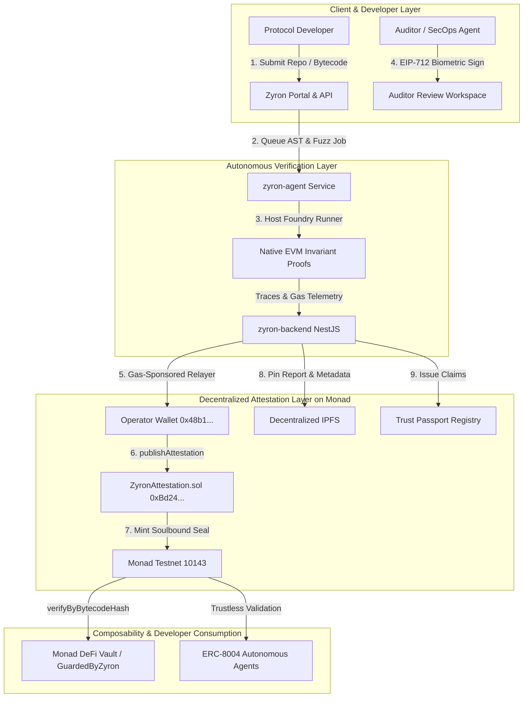

# 🛡️ Zyron: The Trust & Attestation Layer for AI Agents & Protocols on Monad

> **Monad Metropolis Hackathon** | **Track**: Trust, Identity & Data Ownership for AI  
> **Deployed on Monad Testnet (`10143`)**: [`0xBd24D2BFFbc69a17aCe69aaF930fC4e0d979c4D3`](https://testnet.monadvision.com/address/0xBd24D2BFFbc69a17aCe69aaF930fC4e0d979c4D3)  
> **Interactive API & OpenAPI Specs**: `http://localhost:4000/docs` (Swagger: `admin` / `zyron2026`)

---

## 📌 Executive Summary & Track Fit

### The Core Problem in an AI-Native Internet
AI has permanently altered assumptions about code generation and digital provenance: autonomous agents can synthesize, deploy, and interact with smart contracts in milliseconds. However, **how does an on-chain protocol, DeFi vault, or peer AI agent trust that bytecode is secure, authentic, and uncompromised without relying on a centralized, closed Web2 platform?**

### Zyron's Solution
Zyron is an **On-Chain Trust, Attestation & Invariant Verification Primitive** built natively for Monad. It decouples security validation from centralized gatekeepers, establishing a composable, non-capturable trust layer where:
1. **Autonomous Invariant Verification (ERC-8004 Validation Layer)**: AI agents and native Foundry host runners synthesize and prove live EVM execution traces against state invariants.
2. **Cryptographic Content Passports (Track Prompt #02)**: Every verified contract bytecode is bound to a SHA-256 binary hash, a Merkleized findings tree, and decentralized IPFS proof artifacts, sealed into an on-chain ERC-721 Soulbound Security Seal.
3. **Decentralized Trust Passports (Track Prompt #06)**: Human auditors and verification agents earn non-transferable, portable on-chain skill credentials verified across Monad without middlemen.
4. **On-Chain Composability (`GuardedByZyron`)**: Any Monad DeFi protocol or agent can enforce attestation gates in 5 lines of Solidity before accepting token deposits or routing calls.

---

## ⚡ Leveraging Monad's Native Primitives

| Monad Feature | How Zyron Leverages It |
|---|---|
| **Native P256 / WebAuthn Precompile** | Frictionless biometric passkey signing (TouchID/FaceID) via Privy embedded wallets, producing verifiable EIP-712/P-256 signatures with 0 gas cost to the user. |
| **ERC-8004 Trustless Agent Standard** | Functions as the **Validation & Reputation Registry** for autonomous AI agents on Monad, recording verifiable task execution and invariant proofs. |
| **BTX Encrypted Mempools** | Guarantees confidential disclosure during exploit triage, preventing MEV searchers from frontrunning disclosed 0-days before mitigations are sealed. |
| **10,000 TPS Parallel EVM** | Makes continuous, per-commit on-chain attestation economically and practically viable at sub-cent gas fees. |

---

## 🏗️ Architecture



---

## 🚀 Quickstart: Developer Integration in 5 Lines

Any protocol or AI agent on Monad can guard their contract interactions using [`GuardedByZyron.sol`](file:///Users/basil/Desktop/codes/Zyron-Monad/zyron-contracts/src/examples/GuardedByZyron.sol):

```solidity
// SPDX-License-Identifier: MIT
pragma solidity ^0.8.24;

import "@zyron/contracts/GuardedByZyron.sol";

contract SafeVault is GuardedByZyron {
    // Pass the deployed ZyronAttestation address on Monad Testnet
    constructor() GuardedByZyron(0xBd24D2BFFbc69a17aCe69aaF930fC4e0d979c4D3) {}

    // Restricts interaction strictly to bytecodes with an active on-chain Zyron attestation
    function depositCollateral(address token) external onlyAttestedTarget(token) {
        // Safe: Token bytecode is cryptographically verified on Monad!
    }
}
```

See [INTEGRATION.md](./INTEGRATION.md) for full SDK and contract documentation.

---

## 📦 Monorepo Structure

- **[`zyron-contracts`](./zyron-contracts)**: Foundry project containing `ZyronAttestation.sol`, `IZyronAttestation.sol`, and `GuardedByZyron.sol`.
- **[`zyron-agent`](./zyron-agent)**: Autonomous AI verification microservice running native host Foundry test synthesis and opcode trace extraction.
- **[`zyron-backend`](./zyron-backend)**: NestJS API server providing EIP-712 payload generation, IPFS pinning, Trust Passport services, and gas-sponsored relayer broadcasting.
- **[`zyron-frontend`](./zyron-frontend)**: Next.js 14 Web3 application supporting Privy biometric authentication, interactive triage workspace, and public Trust Passports.

---

## 🏆 Hackathon Evaluation Matrix

| Judging Criterion | Zyron Implementation | Weight |
|---|---|---|
| **Technical Execution** | Live smart contract deployed on Monad Testnet (`0xBd24...`), native Foundry host runner, EIP-712 typed signing, gas-sponsored relayer fallback, 124 passing backend tests, 24 passing agent tests. | **20%** |
| **Design & Craft** | First-class developer experience: Solidity interface (`IZyronAttestation`), ready-to-inherit `GuardedByZyron`, comprehensive Swagger OpenAPI docs, clean Privy WebAuthn UX. | **20%** |
| **Originality & Track Insight** | Real, non-simulated bytecode verification; decentralized Content & Trust Passports immune to single-platform capture; aligns directly with ERC-8004 Validation Layer. | **15%** |
| **Founder & Market Readiness** | Clear target customers: Monad DeFi protocols, cross-chain bridge adapters, and autonomous AI agents needing verifiable bytecode guarantees before capital allocation. | **25%** |
| **Traction & Path Forward** | Verified against real production protocols (`Wype` Escrow, `GhostFi`); clear roadmap for mainnet ERC-8004 registry integration and automated bounty escrow. | **20%** |

---

## 🗺️ Strategic Roadmap & Future Implementations

Zyron is engineered to establish the default security and trust primitive for high-throughput parallel EVMs and the autonomous AI agent economy. Our trajectory spans four distinct phases:

### Phase 1: Testnet Foundation & Core Primitives (Live • Q2–Q3 2026)
- [x] **Monad Testnet Registry**: Deployed and verified on Monad Testnet (Chain ID 10143) at [`0xBd24D2BFFbc69a17aCe69aaF930fC4e0d979c4D3`](https://testnet.monadvision.com/address/0xBd24D2BFFbc69a17aCe69aaF930fC4e0d979c4D3).
- [x] **Gas-Sponsored Relayer**: Operator hot wallet ([`0x48b106E3C8681D08c513268854Aef257883298d3`](https://testnet.monadvision.com/address/0x48b106E3C8681D08c513268854Aef257883298d3)) covering 100% of Monad testnet transaction fees.
- [x] **Dual-Engine Prover**: AST invariant evaluation engine paired with `zyron-agent` ephemeral Anvil EVM sandbox attack simulation.
- [x] **On-Chain Defenses**: `GuardedByZyron.sol` modifier with `onlyAttestedTarget` gatekeeping and Soulbound ERC-721 security seals.
- [x] **Biometric Sign-Off**: Auditor reviews signed biometrically using Monad-native P256 / WebAuthn passkeys via Privy.

### Phase 2: Design Partners & Developer CI/CD (In Progress • Q4 2026)
- [ ] **Protocol Design Partners**: Onboarding the first 10 Monad ecosystem DeFi protocols and vaults with guaranteed 48-hour SLA turnaround.
- [ ] **GitHub Actions PR Scanner**: Automated CI/CD security bot analyzing pull requests on commit and flagging invariant regressions.
- [ ] **MonadVision Trust Passport**: Deep-link integration with Monad block explorers to display live verified audit seals directly on contract pages.
- [ ] **Self-Serve Audit Portal**: Instant scope calculator, quote generator, and automated Foundry test suite export.

### Phase 3: Monad Mainnet & Commercial ARR (H1 2027)
- [ ] **Monad Mainnet Deployment**: Genesis deployment alongside the launch of Monad Mainnet.
- [ ] **$1.2M ARR Target**: Scaling to 35 active recurring protocol subscribers on continuous CI/CD PR scanning plans ($1,500–$4,500/mo).
- [ ] **ERC-8004 AI Agent Registry**: Machine-to-machine validation layer enabling autonomous trading agents to verify target contracts before signing transactions.
- [ ] **Enterprise Telemetry API**: Institutional risk telemetry feeds for DeFi insurance underwriters (e.g., Nexus Mutual) and asset allocators.

### Phase 4: Long-Term Expansions & Decentralization (H2 2027+)
- [ ] **Parallel EVM Mempool Guard Rails**: Pre-execution transaction filter intercepting invariant-breaking exploit calls before state commit.
- [ ] **Automated Exploit Proof Bug Bounty Escrow**: Trustless bounty resolution where researchers submit Foundry `.t.sol` proofs and receive instant escrow payouts.
- [ ] **Cross-Chain Attestation Relays**: Relaying Monad-anchored bytecode attestations to Ethereum, Arbitrum, Base, and MegaETH via LayerZero/CCIP.
- [ ] **Decentralized Staked Verifier Network**: Proof-of-Audit network where independent security researchers stake capital to back invariant proofs, with automated slashing for false approvals.
- [ ] **Self-Healing Code Remediation**: AI synthesis of exact Solidity bug fixes verified by passing invariant test suites.

---

## 📄 License
MIT License. Built with ❤️ for the Monad Metropolis Hackathon.
